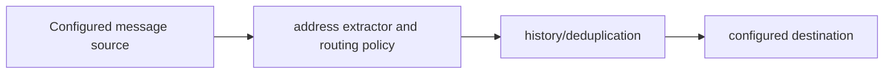

# Contract Message Router

**Extract contract addresses, apply routing rules and retain message history.**

  [](LICENSE)

[Overview](#overview) · [Quickstart](#quickstart) · [Example](#example) · [Validation](#validation) · [Documentation](#documentation)

## Overview

A Telegram message pipeline for extracting contract addresses, applying routing rules and retaining local history.

**Stack:** Python · Telethon · SQLite · httpx · typed configuration · pytest

## Routing with persistent deduplication

| Component | Behavior |
| --- | --- |
| Extract | Message parsing identifies supported contract-address candidates. |
| Route | Configured sources/destinations and network rules determine forwarding. |
| Remember | SQLite history prevents duplicate processing across runs. |

## Processing path



## Quickstart

```console
python -m venv .venv
# Activate .venv, then:
python -m pip install -e .
telegram-token-forwarder --help
```

The commands above install prerequisites or run the specified offline checks. Live collection, cloud operations, messaging and trading are separate operational steps when present.

## Example

**Inspect the workflow**

Inspect the source-chat, destination and network rules in [.env.example](.env.example). A message containing a supported address becomes an extraction candidate, is checked against routing/history state, and may be forwarded to the configured destination. Reprocessing the same history entry should follow the repository deduplication policy.

## Configuration and storage

Python 3.10+, Telethon and SQLite. `DRY_RUN`, `SOURCE_CHATS`, `DESTINATION_CHAT`, `STATE_DB` and `TELEGRAM_SESSION` control the forwarder. The separate wallet-guard command has independent dry-run, signing and broadcast settings.

## Repository guide

| Location | Responsibility |
| --- | --- |
| [src/token_forwarder/cli.py](src/token_forwarder/cli.py) | Forwarder CLI |
| [src/token_forwarder/extractor.py](src/token_forwarder/extractor.py) | Address extraction |
| [src/token_forwarder/history.py](src/token_forwarder/history.py) | Deduplication/history |
| [src/wallet_guard](src/wallet_guard) | Separate wallet-guard implementation |

## Validation

The quickstart lists the declared checks. No passing CI or coverage claim is implied by the technology badges.

## Scope and operational boundaries

The repository also includes wallet-guard execution code. Its full scope is not read-only. Real Telegram sessions, outgoing messages and wallet operations require deliberate account configuration; session files and wallet material remain local.

## Documentation

- The repository guide above links directly to the implementation and configuration files.

## License and attribution

Project-authored source code is licensed under the [MIT License](LICENSE). Third-party components and datasets retain their respective rights and licenses.
