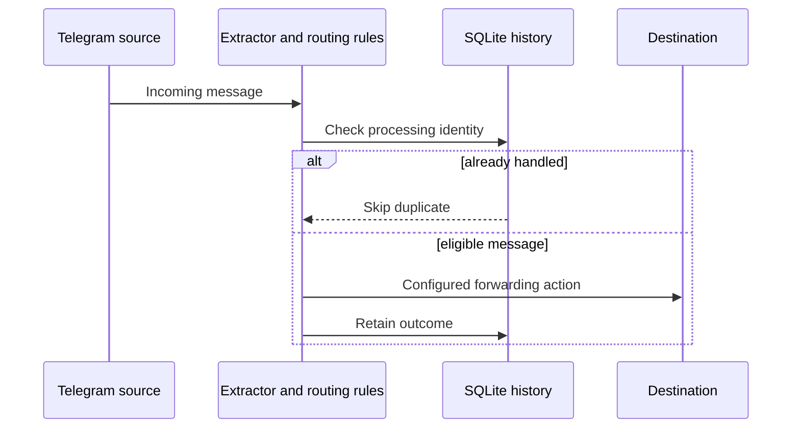

# Contract Message Router

  [](LICENSE)

Extract contract addresses from Telegram messages, apply source/destination rules and retain forwarding history in SQLite.

The forwarder is useful when several feeds need a consistent extraction and deduplication policy. A separate `wallet_guard` package is also included; it has signing/broadcast capabilities and is not required to understand message routing.

## Address extraction without Telegram

After installing the package:

```console
python -m pip install -e .
python -c "from token_forwarder.extractor import extract_contracts; print(extract_contracts('Token: 0x0000000000000000000000000000000000000001', 'evm'))"
```

Expected local result:

```text
('0x0000000000000000000000000000000000000001',)
```

The public address is synthetic. [extractor.py](src/token_forwarder/extractor.py) preserves encounter order, deduplicates EVM addresses case-insensitively and checks that Solana Base58 candidates decode to 32 bytes. The single-contract helper returns `None` for zero or multiple candidates.

## From candidate to forwarded message



`SOURCE_CHATS`, `DESTINATION_CHAT`, `TELEGRAM_SESSION`, `STATE_DB` and `DRY_RUN` are documented in [.env.example](.env.example). `telegram-token-forwarder --help` displays the forwarder's interface. Session creation and forwarding contact Telegram; configure only accounts and destinations you control.

## Two operational surfaces

[routing.py](src/token_forwarder/routing.py) and [history.py](src/token_forwarder/history.py) implement the message path. [wallet_guard](src/wallet_guard) separately implements discovery, preflight, signing and broadcast-related code with its own configuration. Do not interpret a forwarding dry-run setting as a global safety switch for every executable in this repository.

Targeted tests cover extraction/routing/history and wallet-guard components. Anvil and provider-facing tests have additional prerequisites; no live messaging or wallet operation is implied by an offline parser example.

**Technology:** Python · Telethon · SQLite · httpx · typed configuration · pytest

Project-authored source: [MIT](LICENSE). Third-party components retain their own notices and terms.
